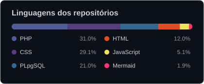

 

 

 

Sou **Gustavo**, estudante de Engenharia de Software e apaixonado por criar produtos digitais que aliam tecnologia e uma boa experiência de uso. Trabalho no desenvolvimento de aplicações e interfaces web, acompanhando o processo desde a organização das ideias e a prototipagem até a implementação. Como **Software Engineer** e **Designer UX/UI**, busco construir soluções funcionais, intuitivas, acessíveis e responsivas, sempre com atenção aos detalhes, às necessidades das pessoas e à qualidade do código.

 

---

<h2>GitHub Dashboard</h2>

Atividade, consistência e tecnologias.

 

 

---

